<picture>
  <source media="(max-width: 700px) and (prefers-color-scheme: light)" srcset="images/profile-mobile-light.svg"/>
  <source media="(max-width: 700px)" srcset="images/profile-mobile.svg"/>
  <source media="(prefers-color-scheme: light)" srcset="images/profile-light.svg"/>
  
</picture>

<a href="https://linkedin.com/in/nikhil-robinson"><picture><source media="(prefers-color-scheme: light)" srcset="images/link-linkedin-light.svg"/></picture></a>
<a href="mailto:nikhil@techprogeny.com"><picture><source media="(prefers-color-scheme: light)" srcset="images/link-email-light.svg"/></picture></a>
<a href="https://www.techprogeny.com/"><picture><source media="(prefers-color-scheme: light)" srcset="images/link-website-light.svg"/></picture></a>
<a href="https://youtube.com/@techprogeny"><picture><source media="(prefers-color-scheme: light)" srcset="images/link-youtube-light.svg"/></picture></a>
<a href="https://instagram.com/techprogeny"><picture><source media="(prefers-color-scheme: light)" srcset="images/link-instagram-light.svg"/></picture></a>
<a href="https://www.fiverr.com/sellers/nikhilrobinson/"><picture><source media="(prefers-color-scheme: light)" srcset="images/link-fiverr-light.svg"/></picture></a>
<a href="https://buymeacoffee.com/nilkhil_robinson"><picture><source media="(prefers-color-scheme: light)" srcset="images/link-coffee-light.svg"/></picture></a>

