<div align="center">



# NR-26

**Engineer-on-Chip** · Datasheet rev B · Nikhil Robinson

`STATUS: IN PRODUCTION` · `ARCH: SoC (formerly MCU)` · `NDA: MOSTLY`

</div>

---

### 1 · General description

The **NR-26** is a high-integration engineer that brings up System-on-Chip platforms all the way from the boot ROM to userspace. It started life as a bare-metal microcontroller part (the NR-MCU series: ESP32, STM32, AVR, CH32) and has since been **re-spun for SoC workloads**, keeping full backward compatibility with RTOS firmware.

Typical applications: new silicon bring-up · secure boot chains · Linux BSPs and kernel drivers · robotics and sensor fusion · edge AI · things that *shouldn't be walking on their own, but do*.

### 2 · Boot sequence



### 3 · Functional blocks

| Block | Function | Implemented with |
|---|---|---|
| 🟢 **CPU cluster** | General compute | C · C++ · Rust · Bash |
| 🟡 **Secure enclave** | Root of trust | Secure Boot · Flash Encryption · AES · signed OTA |
| 🟡 **Boot ROM** | Boot chain | U-Boot · A/B updates · board bring-up over JTAG/SWD |
| 🔵 **Application subsystem** | Linux / BSP | Kernel drivers · Device Tree · Yocto · Buildroot · Qt · Slint · LVGL |
| 🟢 **RT core** | Hard real-time | FreeRTOS · Zephyr · ESP-IDF |
| 🔴 **NPU / vision** | On-device AI | PyTorch · TensorFlow · Keras · OpenCV |
| 🔴 **Motion engine** | Robotics | ROS 2 · AHRS · sensor fusion · navigation |
| 🔵 **RF front-end** | Connectivity | Wi-Fi · BLE · LoRaWAN · LTE · NB-IoT · NFC/RFID |
| ⚪ **Pad ring** | I/O | SPI · I2C · UART · I2S · CAN · USB · Ethernet · MQTT · TCP/UDP · WebSockets |
| ⚪ **Test & debug** | DFT | TDD · hardware-in-the-loop · GitHub Actions · GitLab CI |

### 4 · Pin configuration

| Pin | Name | Type | Description |
|:-:|---|:-:|---|
| 1 | [`LINKEDIN`](https://linkedin.com/in/nikhil-robinson) | I/O | Professional bus |
| 2 | [`EMAIL`](mailto:nikhil@techprogeny.com) | I/O | Direct interrupt line. Lowest latency. |
| 3 | [`WEB`](https://www.techprogeny.com/) | O | Techprogeny |
| 4 | [`YOUTUBE`](https://youtube.com/@techprogeny) | O | Video out |
| 5 | [`INSTAGRAM`](https://instagram.com/techprogeny) | O | Image out |
| 6 | [`FIVERR`](https://www.fiverr.com/sellers/nikhilrobinson/) | I | Contract input |
| 7 | [`COFFEE`](https://buymeacoffee.com/nilkhil_robinson) | PWR | Supply rail. Do not leave floating. |
| 8 | `GND` | — | Datasheets. Always grounded in them. |

### 5 · Absolute maximum ratings

| Parameter | Min | Typ | Max | Unit |
|---|:-:|:-:|:-:|---|
| Coffee supply | 1 | 3 | 6 | cups/day |
| Bug depth traced | boot ROM | — | userspace | layers |
| Datasheet re-reads per errata | 1 | 2 | ∞ | — |
| Tolerance to "it's done" from marketing | — | — | 0 | — |

> ⚠️ Operating outside these ratings may result in firmware that keeps working long after everyone said it was finished.

### 6 · Design rules

1. Treat firmware like production software, because it is.
2. Write the docs for whoever debugs it at 2 a.m. (usually yourself).
3. Test it like it's going to space.
4. Read the datasheet, then the errata, then the datasheet again.

<details>
<summary><b>7 · Errata</b> (known issues in this revision)</summary>

| ID | Description | Workaround |
|---|---|---|
| NR-E01 | Most current work is under NDA and can't be shown here. | Get in touch via pin 2. |
| NR-E02 | Small but non-zero chance the lab explodes. | None. Working as intended. |
| NR-E03 | Will read the full reference manual before replying to "quick question". | Allow extra latency. |

</details>

### 8 · Telemetry

<div align="center">


</div>

### 9 · Ordering information

Building on an SoC and need someone who can follow a bug from the boot ROM to userspace? **Assert pin 2.**

```text
NR-26 - SOC - BRINGUP - LINUX - RT - SEC
  │      │      │        │      │     └── secure boot option
  │      │      │        │      └──────── real-time co-processor
  │      │      │        └─────────────── embedded Linux / BSP
  │      │      └──────────────────────── first silicon support
  │      └─────────────────────────────── System-on-Chip
  └────────────────────────────────────── Nikhil Robinson
```
